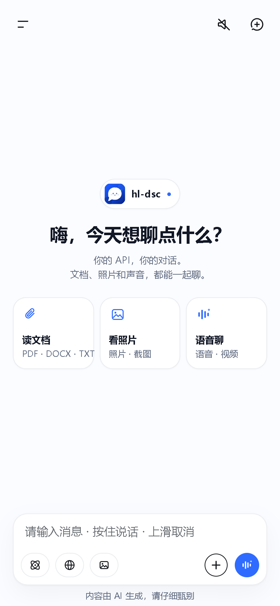
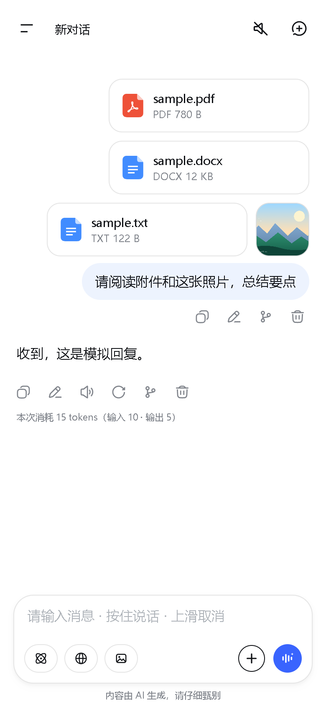
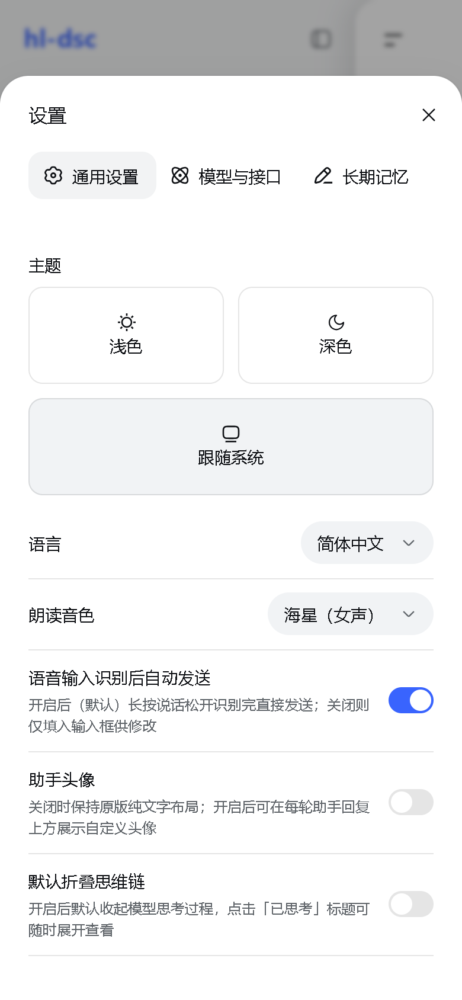
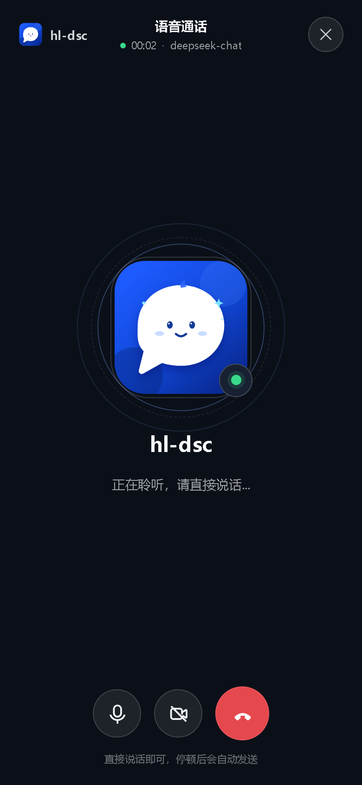

<div align="center">



# hl-dsc

**A lightweight mobile AI chat client with a DeepSeek-like interface**

Bring your own API · PDF / DOC / TXT / photos · Continuous voice & video calls · No client-side censorship

[中文](README.md) · [Download Android APK](https://github.com/sizhenhualei/hl-dsc/releases/latest) · [Issues](https://github.com/sizhenhualei/hl-dsc/issues)

</div>

---

## Why hl-dsc

hl-dsc is a mobile-first AI chat client. The interface follows the calm, spacious feel of the DeepSeek app — generous whitespace, a rounded input pill, restrained icons — but this is not an official DeepSeek product. It gives the model endpoint back to you: any OpenAI-compatible API works, and DeepSeek native, OpenAI Responses, and local model servers are supported too.

There is no account system, no built-in content moderation, and no forced sign-in. Chats, attachments and API keys stay on your device.

## Screenshots

| Home | Chat & attachments | Settings | Voice call |
| :---: | :---: | :---: | :---: |
|  |  |  |  |

## Features

### Custom API

- **OpenAI-compatible**: `POST {base}/v1/chat/completions`, streaming, `reasoning_content`, `usage`, custom headers.
- **OpenAI Responses**: `POST {base}/v1/responses`.
- **DeepSeek native**: official file upload, web search, link reading, and native ASR/TTS.
- **Local models**: connect directly to Ollama, LM Studio, vLLM, LocalAI and similar keyless servers.
- **Optional API key**: leave it empty for local endpoints; `Authorization` is sent only when a key exists.
- Custom system prompt, temperature, top-p, max tokens, and reasoning effort.
- Fetch the model list from the endpoint, or type any model name manually.

### Documents & photos

- Reads **PDF, DOCX, legacy DOC, TXT, Markdown, CSV, JSON, source code** and many other text formats.
- Accepts **PNG / JPG / JPEG / WebP / GIF / BMP / TIFF / AVIF** photos, multiple at a time.
- PDF text layers are extracted locally with `pdfjs-dist`; DOCX uses `mammoth`; legacy DOC uses an OLE / Word piece-table parser.
- Extracted text is injected into the request as `[文件：filename]`, with no dependency on the DeepSeek Files API.
- Up to **80,000 characters per file** (with an explicit truncation marker), 50 attachments per message, 64 MB per file.
- For custom APIs, photos are compressed to a **1600 px** longest edge and sent as data URLs.
- Optional third-party vision/OCR channels are supported; scanned PDFs can be routed through OCR.

### Continuous voice & video calls

- Full-screen continuous voice call with automatic VAD turn-taking, streaming replies, and barge-in.
- Mute, hang up, and live captions.
- Camera on/off with front/back switching; a camera frame is attached to that turn for multimodal models.
- ASR uses `POST {base}/audio/transcriptions`, TTS uses `POST {base}/audio/speech`; each channel can have its own base URL, key, model and voice.
- With DeepSeek native mode, speech capabilities follow the main service.

### No client-side censorship

- The client never sends `safety_check`, never blocks keywords, and never generates a local refusal.
- When a server returns `finish_reason: content_filter` or `stop_reason: refusal`, already streamed content is preserved, displayed, and remains usable in context.
- What the model says is determined by the API service you choose and its policies; hl-dsc adds no extra client-side layer.

### More

- Long-term memory with cross-chat recall; view, edit and delete entries.
- Token usage for every reply and optional daily quota reminders.
- Conversation search, branch editing, regenerate, read aloud, copy, and export as image.
- ZIP history import/export, compatible with DeepSeek `export_format_version: 3` archives.
- In-app update check against GitHub Releases.
- Android build via Capacitor with system back button, file saving, camera and microphone permissions.

## Quick start

Requires Node.js 22+ and pnpm:

```bash
git clone https://github.com/sizhenhualei/hl-dsc.git
cd hl-dsc
pnpm install
pnpm dev
```

Open <http://localhost:8090>. On first launch, **Settings → Model & API** opens:

1. Choose **OpenAI-compatible (/v1/chat/completions)**.
2. Enter an API base URL, e.g. `https://api.openai.com/v1`.
3. Enter an API key; leave blank for local servers.
4. Enter a model name such as `gpt-4o-mini`, or click **Fetch models**.

### Common API endpoints

| Service | Base URL | Notes |
| --- | --- | --- |
| OpenAI | `https://api.openai.com/v1` | API key required |
| DeepSeek (OpenAI-compatible) | `https://api.deepseek.com/v1` | API key required |
| Ollama | `http://127.0.0.1:11434/v1` | Usually keyless |
| LM Studio | `http://127.0.0.1:1234/v1` | Usually keyless |
| vLLM | `http://127.0.0.1:8000/v1` | Usually keyless |

> A browser calling a third-party API directly requires that API to allow CORS. The Android app forwards requests through a native bridge, avoiding browser CORS; `pnpm preview` also includes a `/__api_proxy__` development proxy.

### Voice / video call setup

Under **Settings → Model & API**, expand:

- **Speech recognition (ASR)**: choose Custom, enter an OpenAI-compatible base URL and model (e.g. `whisper-1`).
- **Speech synthesis (TTS)**: choose Custom, enter the base URL, model (e.g. `tts-1`) and voice (e.g. `alloy`).
- Video calls require the main chat model to accept image input; camera frames are sent with the transcribed voice turn.

## Android

### Direct download

Download the latest `hl-dsc-v*-debug.apk` from [Releases](https://github.com/sizhenhualei/hl-dsc/releases/latest), allow "install unknown apps", and install. The current build is debug-signed and intended for testing.

### Download from GitHub Actions

Every push to `main` triggers [Build hl-dsc Debug APK](https://github.com/sizhenhualei/hl-dsc/actions/workflows/android-debug.yml). Download the installable debug APK from the run's **Artifacts** section (`hl-dsc-debug-apk`).

### Build locally

Requires JDK 17 and the Android SDK:

```bash
pnpm run android:sync
cd android
./gradlew assembleDebug
```

The APK is written to `android/app/build/outputs/apk/debug/app-debug.apk`.

- Application ID: `com.hldsc.app`
- Minimum Android: 5.1 (API 22)
- Target SDK: 34
- Signed release builds: push a `v*` tag to run `.github/workflows/android-release.yml`; configure `SIGNING_KEYSTORE_BASE64` and related secrets first.

## Data & privacy

- Chats, messages and attachment blobs live in **IndexedDB**; settings live in **localStorage**.
- No analytics, no telemetry, no account backend.
- Network requests go only to the API endpoints you configure, plus optional vision/OCR/ASR/TTS/image-generation channels.
- With DeepSeek native mode, non-image attachments are uploaded through the official Files API. With other protocols, files are parsed locally and only the extracted text or compressed image is sent to your configured service.
- API keys are stored in local localStorage. Do not keep sensitive keys on a shared device.

## Tech stack

React 18 · TypeScript · Rspack 2 · Zustand · IndexedDB (`idb`) · Capacitor 6 · `pdfjs-dist` · `mammoth` · `cfb`

## Known limitations

- Scanned PDFs without a text layer require an OCR channel.
- Legacy `.doc` parsing is best-effort; complex layouts and embedded objects may be lost.
- Voice calls depend on your ASR/TTS service. Browsers require HTTPS or localhost for microphone/camera access.
- This project is not the official DeepSeek client and is not affiliated with DeepSeek.

## License & credits

[MIT License](LICENSE). Based on [YanJiuWeiYuanHui/DeepChat](https://github.com/YanJiuWeiYuanHui/DeepChat) (MIT), with UI inspiration from DeepSeek's open-source static chat frontend. See [NOTICE.md](NOTICE.md).
