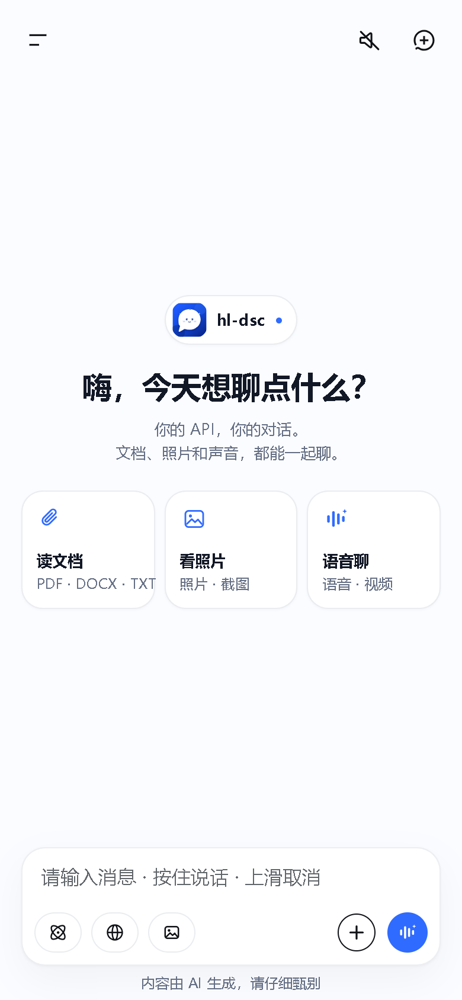
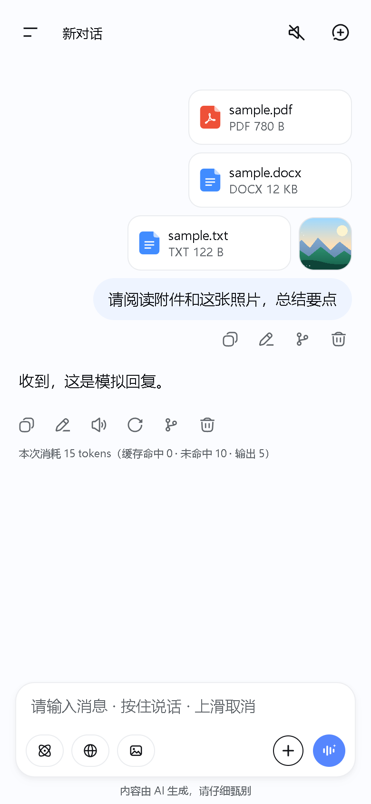
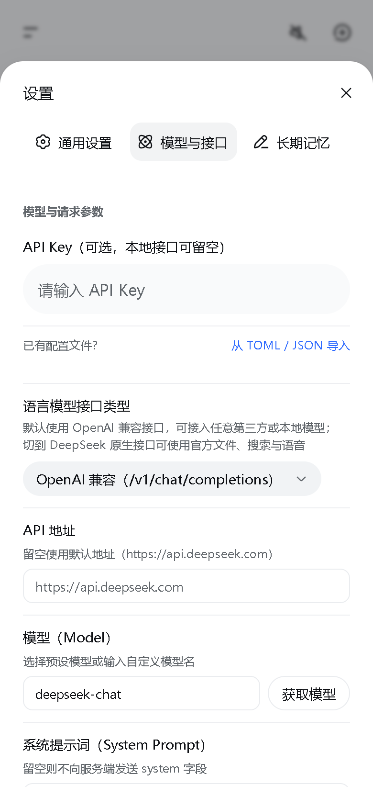
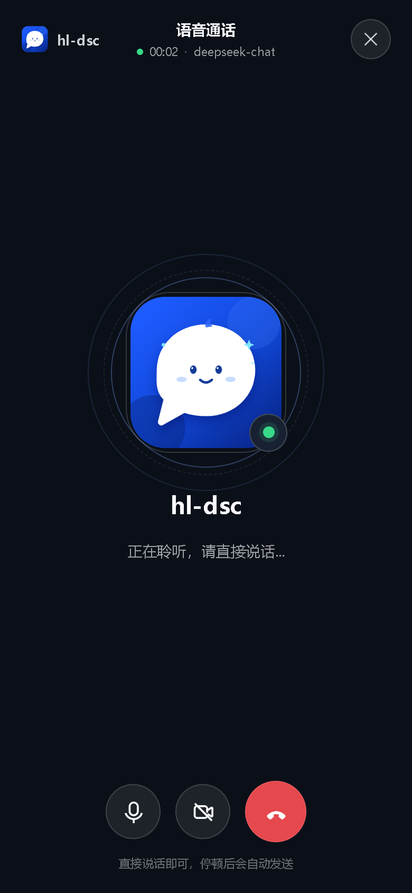

<div align="center">



# hl-dsc

**像 DeepSeek App 一样简洁，但有自己的清爽设计语言**

自定义 API · PDF / DOC / TXT / 图片 · 全屏语音与视频通话 · 无 App 端审查

[English](README.en.md) · [下载 Android APK](https://github.com/sizhenhualei/hl-dsc/releases/latest) · [问题反馈](https://github.com/sizhenhualei/hl-dsc/issues)

</div>

---

## 为什么是 hl-dsc

hl-dsc 是一个移动端优先的轻量 AI 聊天客户端：以手机版 DeepSeek 的留白和克制为参考，但不是 DeepChat 的复刻。原创小团子 mascot、三张快捷卡片和独立全屏通话界面，构成自己的清爽设计语言。它把「模型接口」交还给你：填入任意 OpenAI 兼容地址即可聊天，也支持 DeepSeek 原生协议、OpenAI Responses 协议以及本地模型服务。

没有账号体系，没有 App 内置的内容审查，没有强制登录。聊天记录、附件和 API Key 都保存在你自己的设备上。

## 截图

| 首页 | 对话与附件 | 设置 | 全屏语音通话 |
| :---: | :---: | :---: | :---: |
|  |  |  |  |

## 功能

### 自定义 API

- **OpenAI 兼容**：`POST {base}/v1/chat/completions`，支持流式输出、`reasoning_content`、`usage`、自定义请求头。
- **OpenAI Responses**：`POST {base}/v1/responses`。
- **DeepSeek 原生接口**：官方文件、联网搜索、链接阅读、官方 ASR/TTS。
- **本地模型**：Ollama、LM Studio、vLLM、LocalAI 等无 Key 服务可直接连接。
- **API Key 可选**：本地接口留空即可；只有配置了 Key 才会发送 `Authorization`。
- 支持自定义系统提示词、Temperature、Top P、Max Tokens、深度思考强度。
- 模型列表可一键拉取，也可手动填写任意模型名。

### 文档与照片

- 支持 **PDF、DOCX、旧版 DOC、TXT、Markdown、CSV、JSON、代码文件** 等大量文本格式。
- 支持 **PNG / JPG / JPEG / WebP / GIF / BMP / TIFF / AVIF** 照片，可一次选择多张。
- PDF 使用 `pdfjs-dist` 在本地提取文字层；DOCX 使用 `mammoth`；旧版 DOC 使用 OLE / Word piece-table 解析。
- 文本文件在本地读取后以 `[文件：文件名]` 形式注入请求，不依赖 DeepSeek Files API。
- 单文件最多提取 **80,000 字**，超出部分会明确标注截断；单条消息最多 50 个附件，单文件最大 64 MB。
- 自定义 API 模式下，图片会压缩到最长边 **1600 px** 后以 data URL 发送，避免超大请求。
- 也可以为视觉/OCR 单独配置第三方端点；扫描版 PDF 可通过 OCR 渠道识别。
- 图片理解需要主模型或「图片理解」渠道支持视觉。仅使用 DeepSeek 原生接口时，聊天 API 不能直接读图；请切换到支持视觉的 OpenAI 兼容模型（如 `gpt-4o-mini`、`qwen-vl-max`），或在设置底部为「图片理解」配置独立视觉模型。若图片理解渠道失败，hl-dsc 会自动回退为把原图交给主模型。

### 连续语音与视频通话

- 独立全屏「连续语音通话 / 视频通话」界面，不是悬浮窗：自动 VAD 断句、自动发送、流式回答、可随时打断。
- 支持麦克风静音、挂断、通话字幕；视频模式下摄像头画面全屏铺满，可前后切换。
- 摄像头画面会作为本轮图片附件发送给多模态模型。
- Android 通话时自动隐藏状态栏与导航栏，并保持屏幕常亮。
- ASR 兼容 `POST {base}/audio/transcriptions`，TTS 兼容 `POST {base}/audio/speech`，可在设置中分别配置独立的地址、Key、模型与音色。
- 使用 DeepSeek 原生协议时，语音能力默认跟随主服务。

### 无 App 端审查

- 客户端不发送 `safety_check`，不做关键词拦截，不做本地拒答。
- 即使服务端返回 `finish_reason: content_filter` 或 `stop_reason: refusal`，已经流式输出的内容也会完整保留、正常显示，并可以继续进入上下文。
- 模型的输出由你配置的 API 服务及其策略决定，hl-dsc 不额外增加一层客户端审查。

### 其他

- 长期记忆与跨对话记忆召回，可查看、编辑、删除。
- 每次回复显示 token 消耗，支持每日额度提醒。
- 会话搜索、回复分支编辑、重新生成、朗读、复制、导出图片。
- 历史记录 ZIP 导入/导出，兼容 DeepSeek `export_format_version: 3` 归档。
- 应用内检查 GitHub Releases 更新。
- Android 使用 Capacitor 打包，支持系统返回键、文件保存、相机与麦克风权限。

## 快速开始

需要 Node.js 22+ 与 pnpm：

```bash
git clone https://github.com/sizhenhualei/hl-dsc.git
cd hl-dsc
pnpm install
pnpm dev
```

打开 <http://localhost:8090>。首次启动会打开「设置 → 模型与接口」：

1. 语言模型接口类型选择 **OpenAI 兼容（/v1/chat/completions）**。
2. 填入 API 地址，例如 `https://api.openai.com/v1`。
3. 填入 API Key；本地服务可留空。
4. 填入模型名，例如 `gpt-4o-mini`，或点击「获取模型」。

### 常见 API 地址

| 服务 | API 地址 | 说明 |
| --- | --- | --- |
| OpenAI | `https://api.openai.com/v1` | 需要 Key |
| DeepSeek（OpenAI 兼容） | `https://api.deepseek.com/v1` | 需要 Key |
| Ollama | `http://127.0.0.1:11434/v1` | 通常无需 Key |
| LM Studio | `http://127.0.0.1:1234/v1` | 通常无需 Key |
| vLLM | `http://127.0.0.1:8000/v1` | 通常无需 Key |

> 浏览器直连第三方 API 时，对方必须允许 CORS。Android App 会通过原生代理转发请求，不受浏览器 CORS 限制；本仓库的 `pnpm preview` 也内置了 `/__api_proxy__` 开发代理。

### 语音 / 视频通话配置

在「设置 → 模型与接口」底部展开：

- **语音识别（ASR）**：切到「自定义」，填写 OpenAI 兼容地址与模型（如 `whisper-1`）。
- **语音合成（TTS）**：切到「自定义」，填写地址、模型（如 `tts-1`）与音色（如 `alloy`）。
- 视频通话需要主对话模型支持图片输入；摄像头帧会随语音转写一起发送。

## Android

### 直接下载

从 [Releases](https://github.com/sizhenhualei/hl-dsc/releases/latest) 下载最新的 `hl-dsc-v*-debug.apk`，允许「安装未知应用」后即可安装。当前提供的是 debug 签名构建，适合直接体验与测试。

### 从 GitHub Actions 下载

每次推送到 `main`，[Build hl-dsc Debug APK](https://github.com/sizhenhualei/hl-dsc/actions/workflows/android-debug.yml) 会自动构建一个可直接安装的 debug APK，在对应运行记录的 **Artifacts** 中下载 `hl-dsc-debug-apk`。

### 本地构建

需要 JDK 17 与 Android SDK：

```bash
pnpm run android:sync
cd android
./gradlew assembleDebug
```

APK 输出在 `android/app/build/outputs/apk/debug/app-debug.apk`。

- 包名：`com.hldsc.app`
- 最低 Android：5.1（API 22）
- 目标 SDK：34
- Release 签名构建：推送 `v*` 标签触发 `.github/workflows/android-release.yml`，需配置 `SIGNING_KEYSTORE_BASE64` 等 Secrets。

## 数据与隐私

- 会话、消息、附件 Blob 保存在浏览器/WebView 的 **IndexedDB**；设置保存在 **localStorage**。
- 没有统计 SDK、没有遥测、没有账号服务器。
- 网络请求只会发往你在设置中填写的 API 地址，以及可选的视觉/OCR/ASR/TTS/生图渠道。
- 使用 DeepSeek 原生协议时，非图片附件会按官方 Files API 上传；使用其他协议时，文件只在本地解析，文本或图片随聊天请求发送给你配置的服务。
- API Key 仅保存在本机 localStorage。请不要在共享设备上保存敏感 Key。

## 技术栈

React 18 · TypeScript · Rspack 2 · Zustand · IndexedDB (`idb`) · Capacitor 6 · `pdfjs-dist` · `mammoth` · `cfb`

## 已知限制

- 扫描版 PDF 没有文字层，需要配置 OCR 渠道。
- 旧版 `.doc` 解析为尽力而为；复杂排版、嵌入对象可能丢失。
- 语音通话依赖你的 ASR/TTS 服务，且浏览器需要 HTTPS 或 localhost 才能访问麦克风/摄像头。
- 本项目不是 DeepSeek 官方客户端，也不隶属于 DeepSeek。

## 许可证与致谢

[MIT License](LICENSE)。本项目基于 [YanJiuWeiYuanHui/DeepChat](https://github.com/YanJiuWeiYuanHui/DeepChat)（MIT）修改，UI 参考 DeepSeek 开源静态聊天前端。详见 [NOTICE.md](NOTICE.md)。
